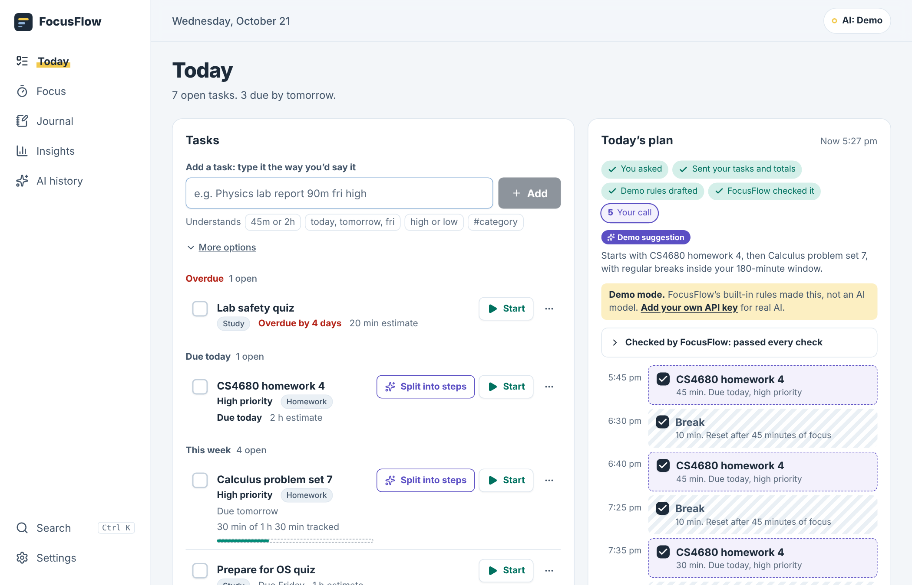
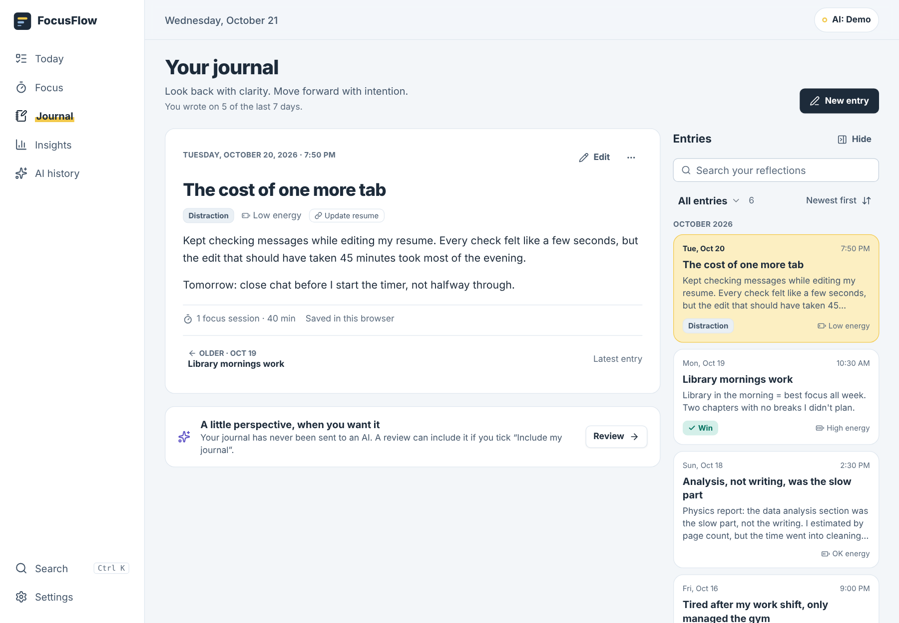
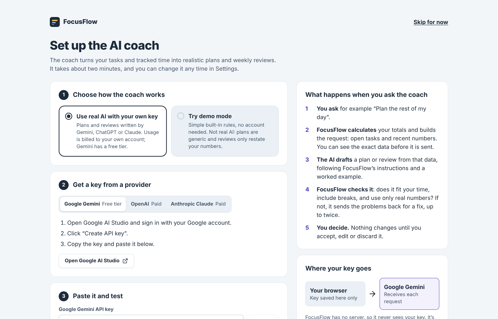
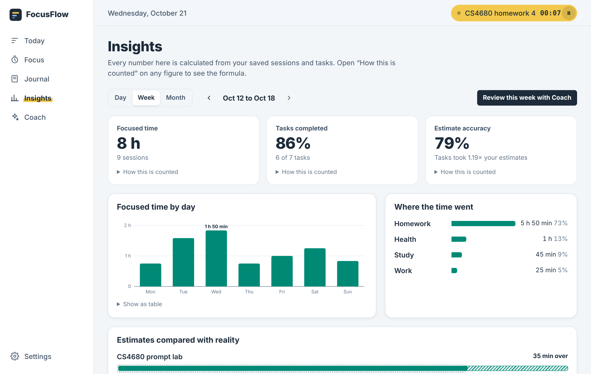

# FocusFlow

**An AI planner, focus timer, and journal that learns how long your work really takes.**

CS4680 Prompt Engineering, AI Assistant Project.

**Live app:** https://anthonyp3n.github.io/CS4680-A3-AI-Assistant-Project/



## The problem

Students plan their days without knowing how long things actually take. A "one-hour" lab report takes two, the plan collapses by 3 pm, and the next plan is just as optimistic. Most planners only record intentions; most time trackers only record history. Neither closes the loop.

FocusFlow closes it: **plan → track → reflect → understand → improve.**

1. Type a task the way you'd say it: `Physics lab report 90m fri high`.
2. Track real time with a focus timer (or log it by hand).
3. Answer a 10-second check-in when you stop: energy, what happened, one line.
4. See planned versus actual time on a dashboard where every number is calculated by code.
5. Ask the AI for a realistic plan, a review of your week, or steps for a big task. You approve every change, and you can undo it.

## What's on each page

| Page | What it does |
|---|---|
| **Today** | Quick add that understands `45m`, `2h`, `today`/`fri`, `high`/`low` and `#category`, with a live preview of what it understood. A category picker with a built-in list (Studying, Homework, Work, Exercise, Health, Personal, Errands, Chores, Bills, Finances, Social, Other) where you can search or create your own; `#study` or `#bills` in quick add matches them too. Tasks grouped into Overdue, Due today, This week and Later. **Plan the rest of my day** sends your open tasks to the AI and shows a timeline you accept block by block. **Split into steps** breaks a big task into subtasks. |
| **Focus** | Start, pause, resume, stop. The timer survives refresh (time comes from timestamps) and shows in the header and tab title on every page. Log time by hand if you forgot to start it. |
| **Journal** | The main area shows one thing at a time: the entry you're reading, or **New entry**. Reading: full text, older/newer links, edit in place, copy, and delete with undo. New entry: a question to start from, an optional title, energy (low / OK / high), tags, an autosaved draft (**Keep as draft** returns to reading), a word count and full-screen writing. Entries sit in a panel on the right with search, filters and newest/oldest order; **Hide** and **Show entries** fold it away (remembered), and on smaller screens it opens as a side sheet. Entries up to 10,000 characters (about 1,500 words). |
| **Insights** | Day, week and month: focused time, completion rate and estimate accuracy (with change from the last period), a day-by-day chart with a table view, time by category, and an estimate-versus-reality ledger. **Write my review** asks the AI for patterns and two suggestions you can add as tasks. |
| **AI history** | Every AI request: what was sent, what came back, how it was checked, tokens used, and what you decided. |



Small things that make it easier to use every day:

- **Undo** on every change (8-second toast), instead of "are you sure?" dialogs.
- **Ctrl K / ⌘K** opens search and commands: jump to a page, start a timer, add a task, plan the day. **N** adds a task from anywhere.
- After **Stop and save**, a short check-in sheet asks how it went. It can be turned off in Settings.
- Two labels tell you where any piece of information came from: a violet **AI suggestion** badge for model output, and a gray **Calculated** badge for numbers computed by code.
- Phone layout with bottom tabs, light and dark themes, keyboard focus outlines, and reduced motion support.

## Bring your own AI key

Each person uses their own key, so nobody is billed for anyone else's usage. The first visit opens a 3-step guided setup; you can also use **Settings → AI coach** at any time.



| Provider | Get a key | Default model | Cost |
|---|---|---|---|
| Google Gemini | [aistudio.google.com/apikey](https://aistudio.google.com/apikey) | `gemini-flash-latest` | Free tier available |
| OpenAI | [platform.openai.com/api-keys](https://platform.openai.com/api-keys) | `gpt-5-mini` | Pay as you go |
| Anthropic Claude | [console.anthropic.com](https://console.anthropic.com/settings/keys) | `claude-haiku-5-5` | Pay as you go |

The key is saved only in that browser (localStorage), sent directly from the browser to the chosen provider, and never included in data exports. **Remove key** deletes it. Model names change often; if a provider says the model wasn't found, type a current one into **Model**. No SDKs are used; each provider is a small `fetch` adapter in `src/lib/providers.js`.

**Demo mode.** Without a key, FocusFlow uses built-in rules that return the same JSON shapes and pass through the same checks. Every result is labeled "Demo suggestion" with a note that it isn't an AI model. Anyone can click through the whole app, and a live demo still works if the Wi-Fi fails.

## How the AI is used, step by step

Each AI action shows a live 5-step progress strip, driven by real events from the request:

1. **You asked**: nothing is sent until you click.
2. **Sent your tasks and totals**: before you click, **See the exact data** shows the JSON that will go out.
3. **Gemini drafted** (or OpenAI, Claude, or Demo rules).
4. **FocusFlow checked it**: if the draft breaks a rule, it shows "sent back 1×" while the model revises.
5. **Your call**: tick the blocks or steps you want, then accept. Undo is one click away.



## Prompt engineering

The core design rule: **the model handles judgment and language; code handles facts and arithmetic.** Every number the AI sees is computed in `src/lib/stats.js`, and every answer is checked in `src/lib/validate.js`.

### 1. Persona (`src/lib/prompts.js`, `PERSONA`)

All three actions share one system prompt that defines *FocusFlow Coach*: calm, practical, realistic over ambitious. The persona also carries the boundaries:

- Work only from the JSON provided; never invent tasks, deadlines or completed work.
- Mark assumptions and uncertainty instead of guessing silently.
- Describe "observed patterns", never character traits. No diagnosis, no moral judgment about productivity.
- Return one JSON object, with short user-facing reasons instead of hidden reasoning.

Why it helps: the same voice and rules apply everywhere, so a review never sounds like a lecture and a plan never pretends to know your calendar.

### 2. Few-shot examples (`planMessages`, `reviewMessages`, `breakdownMessages`)

Each request is sent as a short conversation: the rules and schema, a **complete worked example** (input → ideal output), then the real input. The examples teach judgment, not only format:

- **Plan:** an over-full day where the plan fits the budget, inserts breaks every 45 minutes, lists what *didn't* fit with a reason, and warns that recent tasks ran 1.25× over estimate.
- **Review:** every claim cites numbers from the input as evidence; exactly two concrete suggestions; journal themes only when the journal was shared.
- **Breakdown:** verb-first steps of 10–90 minutes that add up to the estimate, with a "done when" finish line and unknowns listed as warnings.

The test suite proves each example passes the same validators the model must pass (`test/validate.test.js`), so the examples never teach a rule violation.

### 3. Iterative refinement (`src/lib/ai.js`, `runWithRefinement`)

```
draft → validate in code → problems?  ── no ──→ show to user
                               │ yes
                               ▼
         send draft back + exact list of problems → revision (max 2)
                               │ still failing
                               ▼
         deterministic safety fallback (plans are re-packed to fit; never invents work)
```

What gets checked:

| Action | Checks |
|---|---|
| Plan | total minutes ≤ available; blocks inside the time window; no overlaps; a break at least every *N* minutes; only real task IDs; every task due within a day is scheduled or explicitly listed as unscheduled |
| Review | 1–4 patterns with evidence; exactly 2 suggestions; **every number must appear in the input data** (with unit conversions allowed); no diagnostic or judgmental words; no journal themes unless the journal was shared |
| Breakdown | 2–8 steps; each 10–90 minutes; total within 25% of the estimate |

A refinement message looks like this:

```
Your draft did not pass FocusFlow's checks:
- The schedule uses 210 minutes but only 180 are available. Remove or shorten
  blocks and list what no longer fits in "unscheduled".
- There are 120 minutes of continuous work ending at 16:00. Insert a 10-minute
  break at least every 45 minutes.

Revise the draft to fix every item above. Keep the parts that already passed...
```

Every result has a **Checked by FocusFlow** section showing each draft, the problems found, and the revision that passed. AI history keeps it for every request.

### Trust and privacy safeguards

- The AI recommends; you accept, edit, or reject each block or step, and every change can be undone.
- **See the exact data** shows the JSON before you send it; AI history keeps a copy afterwards.
- Journal text is sent only when you tick **Include my journal** on a review: only that period's entries (at most 12), each cut to its first 400 characters. The Journal page shows when it was last shared.
- User free text is length-limited and passed as data inside the JSON input.
- Timeouts, one retry on rate limits and server errors, and readable error messages (bad key, unknown model, quota).

## How it is built

React 19, Vite, Tailwind CSS v4 and [shadcn/ui](https://ui.shadcn.com) components (Radix primitives), with lucide icons, sonner toasts, cmdk for the command palette and Recharts for the Insights chart (loaded only when Insights opens). Everything runs in the browser, so there is no server and no backend bill.

```
src/
  main.jsx, App.jsx        Entry, hash routes (#today, #focus, #journal, ...)
  index.css                Design tokens (light and dark) and Tailwind setup
  components/ui/           shadcn/ui components: button, dialog, sheet, select, ...
  components/ai.jsx        Shared AI pieces: badges, live pipeline, check log,
                           "what will be sent" preview, token note
  components/layout/       App shell: sidebar, header, timer pill, mobile tabs
  features/
    today/                 Quick add, task list, split into steps, plan panel
    focus/                 Timer, log time, check-in sheet after a session
    journal/               Reader, New entry form, entries panel
    insights/              Tiles, chart, ledger, AI review
    history/               AI request log
    settings/, setup/      AI key settings and first-run guided setup
    command/               Ctrl K command palette
  state/                   App data context with undo, UI context
  data/
    backend.js             The app's "server", running in the browser: REST-style
                           routes, data in localStorage, all-or-nothing saves,
                           undo snapshots, sync across open tabs
    api.js                 The function components use to call those routes
  lib/
    stats.js               All dashboard math (deterministic)
    prompts.js             Persona, few-shot examples, refinement message
    validate.js            Output checks, plan repair, grounding check
    ai.js                  Input building, refinement loop, progress events
    providers.js           Gemini / OpenAI / Anthropic adapters (fetch only)
    demoAI.js              Demo-mode rules
    quickadd.js            Parses "Lab report 90m fri high #physics"
    categories.js          Built-in categories, matching and clean-up
    inputs.js, text.js     Input limits and journal word counts
    db.js, seed.js         Data shape, upgrades and sample data
test/                      44 tests: stats, validators, refinement loop with a
                           fake model, quick add, journal limits, the backend
.github/workflows/         Tests, builds, then publishes dist/ to GitHub Pages
```

**Metrics, defined:**

- *Focused time*: sum of saved sessions ending in the period.
- *Completion rate*: completed tasks ÷ tasks due in the period or finished in it.
- *Estimate accuracy*: per task, smaller of (estimate, actual) ÷ larger, averaged over finished tasks with tracked time. 100% is a perfect estimate.

## Run it on your computer

Needs Node.js 20.19 or newer.

```bash
npm install
npm run dev        # http://localhost:5173, reloads as you edit
```

| Command | What it does |
|---|---|
| `npm run dev` | Development server at http://localhost:5173 |
| `npm test` | Run the 44 tests |
| `npm run build` | Build the site into `dist/` |
| `npm run preview` | Serve the built `dist/` to check it before publishing |

To try it with realistic data, click **Load a sample week instead** on the empty Today page, or **Settings → Replace with sample week** (undo is offered).

Your data lives in your browser. **Settings → Export my data** downloads a backup file and **Import a backup** restores it, on any browser or computer. The API key is never in the backup.

## Publishing

Pushing to `main` or `master` runs the tests, builds the site and publishes it to GitHub Pages. See [DEPLOY.md](DEPLOY.md).

## Roadmap

Optional sync across devices, recurring tasks and reminders, calendar import/export, monthly trend reports, and user-selectable coaching styles (a natural extension of the persona pattern).

## Presenting

See [DEMO.md](DEMO.md) for the live demo script and the short-video storyboard.
