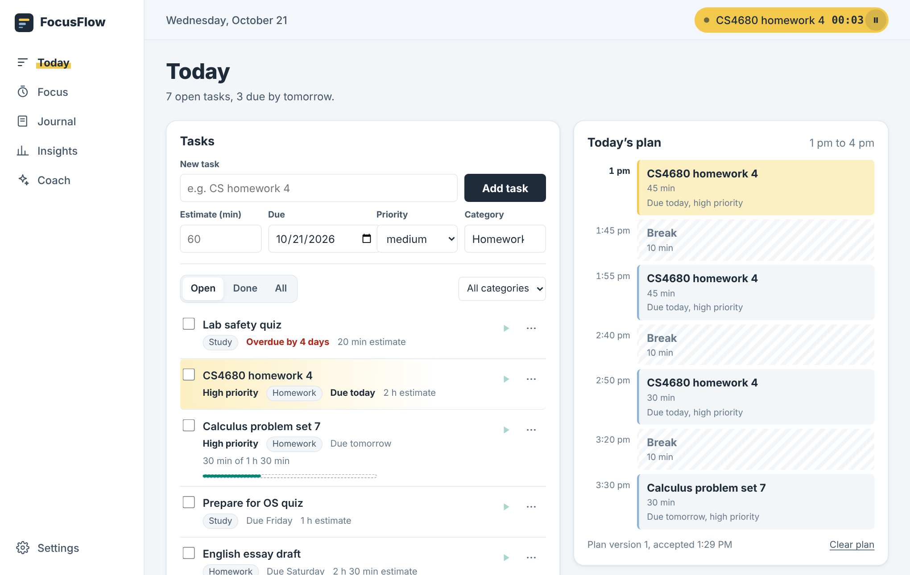
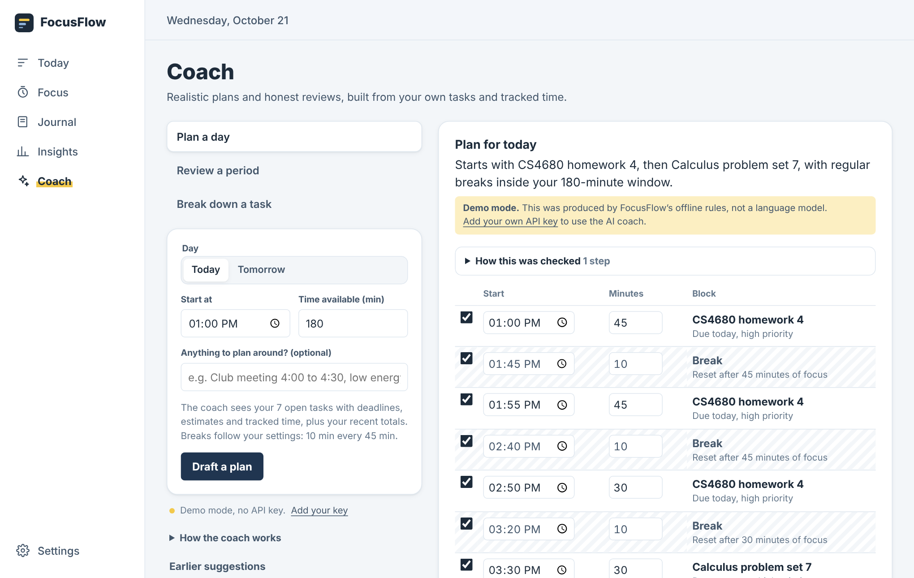

# FocusFlow

**An AI planner, focus timer, and journal that learns how long your work really takes.**

CS4680 Prompt Engineering, AI Assistant Project.

**Live app:** `https://YOUR-USERNAME.github.io/focusflow/` (see [DEPLOY.md](DEPLOY.md) to publish your own copy)



## The problem

Students plan their days without knowing how long things actually take. A "one-hour" lab report takes two, the plan collapses by 3 pm, and the next plan is just as optimistic. Most planners only record intentions; most time trackers only record history. Neither closes the loop.

FocusFlow closes it: **plan → track → reflect → understand → improve.**

1. Add tasks with deadlines and a time estimate.
2. Track real time with a focus timer (or log it by hand).
3. Write a short private reflection.
4. See planned versus actual time on a transparent dashboard.
5. Ask the AI coach for a realistic plan or a review of your week. You approve every change.

## Features

| Area | What it does |
|---|---|
| **Today** | Quick task entry, filters, subtasks, and a timeline of the accepted plan with the current block highlighted. |
| **Focus** | Start, pause, resume, stop. Survives refresh and network loss (time is computed from timestamps). Log time by hand if you forgot to start it. |
| **Journal** | Private entries with tags. Never sent to the AI unless you tick "Include my journal" for a review. Export or delete at any time. |
| **Insights** | Day, week and month views: focused time, completion rate, estimate accuracy, time by category, and an estimate-versus-reality ledger. Every figure explains its formula. |
| **Coach** | Three AI actions: **Plan a day**, **Review a period**, **Break down a task**. Results are editable and nothing is saved until you accept. |



## Quick start

FocusFlow is a static web app: everything runs in the browser, so there is no server to set up and no backend bill.

- **Use it online:** open the published GitHub Pages link above. To publish your own copy, follow [DEPLOY.md](DEPLOY.md).
- **Run it on your computer** (Node.js 18.17 or newer):

  ```bash
  npm install
  npm start          # http://localhost:3000
  ```

To try it with realistic data, click **Load a sample week instead** on the empty Today page, or use **Settings → Replace with sample week**.

### Bring your own AI key

Each person uses their own key, so nobody is billed for anyone else's usage. Open **Settings**, choose a provider, paste a key, click **Test connection**, then **Save settings**.

| Provider | Get a key | Default model | Cost |
|---|---|---|---|
| Google Gemini | [aistudio.google.com/apikey](https://aistudio.google.com/apikey) | `gemini-flash-latest` | Free tier available |
| OpenAI | [platform.openai.com/api-keys](https://platform.openai.com/api-keys) | `gpt-5-mini` | Pay as you go |
| Anthropic Claude | [console.anthropic.com](https://console.anthropic.com/settings/keys) | `claude-haiku-5-5` | Pay as you go |

The key is saved only in that browser (localStorage), sent directly from the browser to the chosen provider, and never included in data exports. **Remove key** deletes it. Model names change often; if a provider says the model wasn't found, type a current one into **Model (optional)**. No SDKs are used; each provider is a small `fetch` adapter in `public/js/lib/providers.js`.

**Demo mode.** Without a key, the coach runs offline rules that return the same JSON shapes and go through the same validators. The UI labels this clearly as *not* an AI model. It lets anyone click through the whole app, and it keeps a live demo working if the Wi-Fi fails.

## Prompt engineering

The core design rule: **the model handles judgment and language; code handles facts and arithmetic.** Every number the AI sees is computed in `stats.js`, and every answer it gives is checked in `validate.js` (both in `public/js/lib/`).

### 1. Persona (`public/js/lib/prompts.js`, `PERSONA`)

All three actions share one system prompt that defines *FocusFlow Coach*: calm, practical, realistic over ambitious. The persona also carries the boundaries:

- Work only from the JSON provided; never invent tasks, deadlines or completed work.
- Mark assumptions and uncertainty instead of guessing silently.
- Describe "observed patterns", never character traits. No diagnosis, no moral judgment about productivity.
- Return one JSON object, with short user-facing reasons instead of hidden reasoning.

Why it helps: the same voice and the same rules apply everywhere, so a review never sounds like a lecture and a plan never pretends to know your calendar.

### 2. Few-shot examples (`planMessages`, `reviewMessages`, `breakdownMessages`)

Each request is sent as a short conversation: the rules and schema, a **complete worked example** (input → ideal output), then the real input. The examples teach judgment, not only format:

- **Plan:** an over-full day where the plan fits the budget, inserts breaks every 45 minutes, lists what *didn't* fit with a reason, and warns that recent tasks ran 1.25× over estimate.
- **Review:** every claim cites numbers from the input as evidence; exactly two concrete suggestions; journal themes only when the journal was shared.
- **Breakdown:** verb-first steps of 10–90 minutes that add up to the estimate, with a "done when" finish line and unknowns listed as warnings.

The test suite proves each example passes the same validators the model must pass (`test/validate.test.js`), so the examples never teach a rule violation.

### 3. Iterative refinement (`public/js/lib/ai.js`, `runWithRefinement`)

```
draft → validate in code → problems?  ── no ──→ show to user
                               │ yes
                               ▼
         send draft back + exact list of problems → revision (max 2)
                               │ still failing
                               ▼
         deterministic safety fallback (plans are re-packed to fit; never invents work)
```

What gets checked:

| Action | Checks |
|---|---|
| Plan | total minutes ≤ available; blocks inside the time window; no overlaps; a break at least every *N* minutes; only real task IDs; every task due within a day is scheduled or explicitly listed as unscheduled |
| Review | 1–4 patterns with evidence; exactly 2 suggestions; **every number must appear in the input data** (with unit conversions allowed); no diagnostic or judgmental words; no journal themes unless the journal was shared |
| Breakdown | 2–8 steps; each 10–90 minutes; total within 25% of the estimate |

A refinement message looks like this:

```
Your draft did not pass FocusFlow's checks:
- The schedule uses 210 minutes but only 180 are available. Remove or shorten
  blocks and list what no longer fits in "unscheduled".
- There are 120 minutes of continuous work ending at 16:00. Insert a 10-minute
  break at least every 45 minutes.

Revise the draft to fix every item above. Keep the parts that already passed...
```

The UI shows this as **"How this was checked"** on every result, so users (and graders) can see the draft, the problems found, and the revision that passed.

### Trust and privacy safeguards

- The AI recommends; the user accepts, edits, or rejects each block or step. Plans are versioned.
- **"What the coach saw"** shows the exact JSON sent with each request.
- Journal text is sent only on explicit opt-in, capped at 12 entries × 400 characters.
- User free text is length-limited and passed as data inside the JSON input.
- Timeouts, one retry on rate limits and server errors, and readable error messages (bad key, unknown model, quota).
- Each AI request logs provider, rounds, latency and pass/fail as one line in the browser console.

## How it is built

```
public/                  The whole app. GitHub Pages publishes this folder.
  index.html, styles.css
  js/
    app.js               Routing, settings, import/export
    api.js               The views' request function
    backend.js           The app's "server", running in the browser:
                         same routes as a REST API, data in localStorage
    views/               today, focus, journal, insights, coach
    lib/
      stats.js           All dashboard math (deterministic)
      prompts.js         Persona, few-shot examples, refinement message
      validate.js        Output checks, plan repair, grounding check
      ai.js              Input building, refinement loop, metrics
      providers.js       Gemini / OpenAI / Anthropic adapters (fetch only)
      demoAI.js          Offline demo-mode rules
      db.js, seed.js     Data shape and sample data
server.js                Local preview server for npm start (static files only)
test/                    23 tests: stats, validators, refinement loop with a
                         fake LLM, and the in-browser backend
.github/workflows/       Tests, then publishes public/ to GitHub Pages
```

The views call routes like `POST /api/tasks` through `backend.js`, which keeps the app structured like a client and server even though both run in the browser. Saves are all-or-nothing: if a change fails validation, nothing is written. Several open tabs stay in sync.

**Metrics, defined:**

- *Focused time*: sum of saved sessions ending in the period.
- *Completion rate*: completed tasks ÷ tasks due in the period or finished in it.
- *Estimate accuracy*: per task, smaller of (estimate, actual) ÷ larger, averaged over finished tasks with tracked time. 100% is a perfect estimate.

## Scripts

| Command | What it does |
|---|---|
| `npm start` | Serve the app at http://localhost:3000 |
| `npm run dev` | Same, restarting on file changes |
| `npm test` | Run the test suite |

Your data lives in your browser. **Settings → Export my data** downloads a backup file and **Import a backup** restores it, on any browser or computer.

## Roadmap

Optional sync across devices, recurring tasks and reminders, calendar import/export, monthly trend reports, an offline-first mobile timer, optional energy tracking, and user-selectable coaching styles (a natural extension of the persona pattern).

## Presenting

See [DEMO.md](DEMO.md) for the live demo script and the short-video storyboard, and [DEPLOY.md](DEPLOY.md) for publishing.
